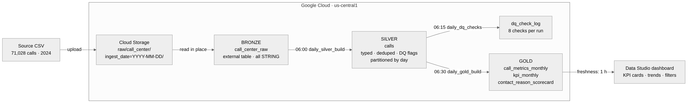
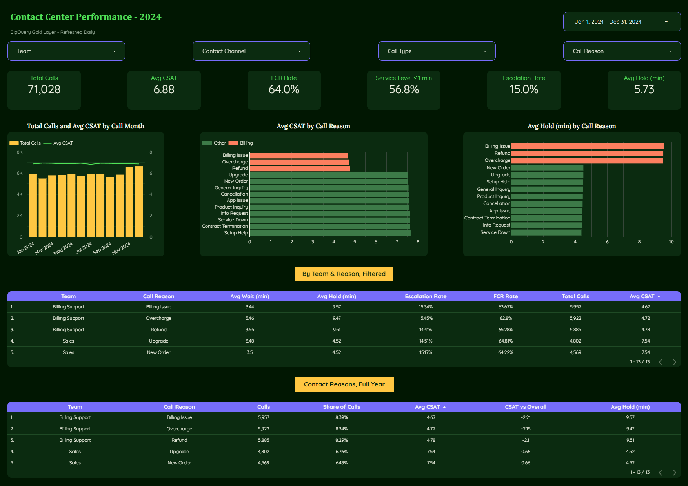
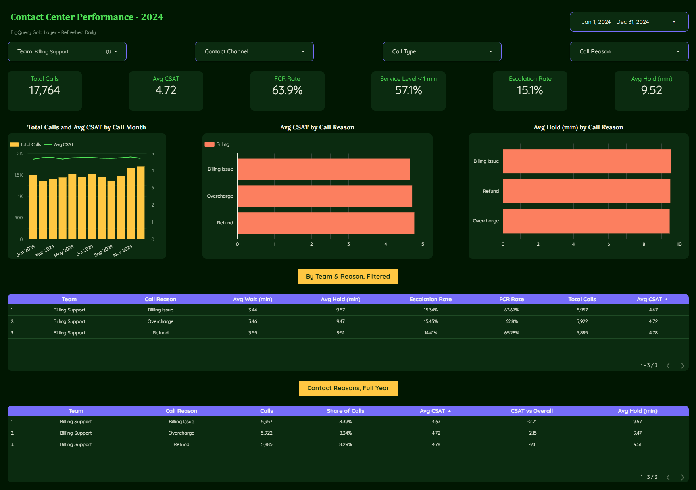

# Contact Center Analytics on GCP — Medallion Pipeline

An end-to-end analytics pipeline on Google Cloud. Raw contact-center call logs land in Cloud Storage, are refined through **bronze → silver → gold** layers in BigQuery, refresh automatically every morning with scheduled queries, and feed a Data Studio (formerly Looker Studio) dashboard of contact-center KPIs.

**Stack:** Cloud Storage · BigQuery (external tables, partitioning, clustering, scheduled queries) · SQL · Data Studio

**Live dashboard:** [Contact Center Performance 2024](https://datastudio.google.com/reporting/749f9492-4bf4-43f2-ace8-2d5bda8aaf98)



---

## Dataset

**Call Center Metrics (synthetic), 2024.** 71,028 call records × 28 columns covering Jan 1 – Dec 31, 2024: channel, contact reason, team, CSAT, first-call resolution, escalation, queue wait, hold time, duration and agent attributes.

Source: [Real World Fake Data](https://sonsofhierarchies.com/real-world-fake-data/), Season 4, by Mark Bradbourne ([GitHub](https://github.com/MBradbourne/real-world-fake-data)). The data is synthetic; public contact-center logs are rarely available because they contain customer data.

---

## Layers

| Layer | Object | What it does |
|---|---|---|
| **Landing** | `gs://…-landing/raw/call_center/ingest_date=YYYY-MM-DD/*.csv` | Raw files partitioned by ingest date, so any day can be reprocessed |
| **Bronze** | `bronze.call_center_raw` | **External table** over the bucket. All columns `STRING`, values untouched, snake_case names. New files are picked up automatically |
| **Silver** | `silver.calls` | Typed, trimmed and deduplicated (one row per `call_id`, latest ingest wins). Rejects rows without a key or a valid timestamp. Adds derived dates, data-quality flags and lineage (`source_file`, `ingest_date`, `processed_at`). **Partitioned by `call_date`, clustered by `team`, `contact_channel`** |
| **Gold** | `gold.call_metrics_monthly` | Fact table at month × team × channel × call type × reason (1,248 rows). Stores **only additive sums and counts**, so ratios are computed at report time and stay correct under any filter |
| | `gold.kpi_monthly` | One row per month: headline KPIs plus month-over-month change |
| | `gold.contact_reason_scorecard` | Full-year scorecard per contact reason, ranked by volume and CSAT, compared with the overall average |

## Daily refresh

| Time (America/Guatemala) | Scheduled query | Action |
|---|---|---|
| 06:00 | `daily_silver_build` | Rebuild `silver.calls` from every file in the landing bucket |
| 06:15 | `daily_dq_checks` *(optional)* | Append the 8 data-quality results to `silver.dq_check_log` |
| 06:30 | `daily_gold_build` | Rebuild the three gold tables from silver |

Failures send an email notification. The dashboard data source has a **1-hour freshness** setting, so the morning refresh is visible by about 07:00.

---

## Data quality

`sql/04_silver_checks.sql` runs 8 checks. **FAIL** means the pipeline is broken; **WARN** means a known source issue that is handled and reported, not hidden.

| Check | Result |
|---|---|
| Silver row count matches bronze (71,028) | PASS |
| No duplicate call IDs · no null timestamps · no null CSAT · CSAT within 1–10 · no negative durations | PASS |
| **FCR flagged but escalated** | WARN, 8,086 calls |
| **Source `hour_of_day` disagrees with the timestamp** | WARN, 5 calls |

Two source-data issues were found and handled:

1. **Daylight-saving gap.** Five calls are stamped `2024-03-10 03:00` but carry `hour_of_day = 2`, an hour that never existed that night. Silver derives the hour and weekday from the timestamp instead of trusting the source column.
2. **Contradictory first-call-resolution flags.** 8,086 calls are flagged FCR = true but also escalated. Silver keeps the raw flag, marks the conflict (`dq_fcr_conflict`), and adds a strict `resolved_first_contact` (FCR and not escalated). Reporting uses the strict version: **64.0%**, versus 75.4% from the raw flag.

---

## Dashboard



Built on the gold layer only. KPI cards, a monthly trend, CSAT and hold time by contact reason, and detail tables, with filters for team, channel, call type and contact reason. KPIs are calculated fields over additive sums, for example `SUM(csat_sum) / SUM(csat_responses)`.

**[Open the live dashboard →](https://datastudio.google.com/reporting/749f9492-4bf4-43f2-ace8-2d5bda8aaf98)**

### KPI definitions

| KPI | Definition |
|---|---|
| CSAT | Average survey score, 1–10. *Top-2-box* = share of 9s and 10s |
| FCR rate | Calls resolved on first contact **and** not escalated ÷ calls |
| Service level (≤1 min) | Calls that waited ≤ 1 minute in queue ÷ calls (source wait times are whole minutes) |
| Escalation rate · Dropped rate | Escalated calls ÷ calls · Dropped calls ÷ calls |
| Avg hold / wait / duration | Total minutes ÷ calls |

## Key findings (2024)

| Metric | Value |
|---|---|
| Calls | 71,028 |
| Avg CSAT | 6.88 / 10 |
| FCR (strict) | 64.0% |
| Service level (≤ 1 min) | 56.8% |
| Escalation rate | 15.0% |
| Avg hold time | 5.73 min |

- **Billing contacts drive dissatisfaction.** Billing Issue, Overcharge and Refund average **CSAT ≈ 4.7**; every other reason averages **≈ 7.6**.
- **Hold time is the likely cause.** Those same three reasons average **≈ 9.5 min on hold**, versus **≈ 4.5 min** for all others. Duration and queue wait are flat across reasons. *Recommendation:* review billing agents' tooling and knowledge base to cut hold time.
- **Seasonal peak.** Volume rises **12.3% in November** and stays high in December, which matters for staffing plans.



---

## Repository

```
sql/
  01_bronze_create.sql       external table over the landing bucket
  02_bronze_profile.sql      row counts, uniqueness, castability
  03_silver_build.sql        typed, deduplicated silver table   (scheduled 06:00)
  04_silver_checks.sql       8 data-quality checks
  05_gold_build.sql          three gold tables                  (scheduled 06:30)
  06_gold_verify.sql         gold totals vs expectations
  07_pipeline_freshness.sql  last build time per layer
  08_dq_check_log.sql        checks + timestamp, appended daily (scheduled 06:15)
docs/
  architecture.png / .mmd
  dashboard_*.png
```

## Reproduce

1. Create a GCP project with billing enabled (required for scheduled queries). Create a bucket and three datasets, `bronze`, `silver` and `gold`, all in `us-central1`.
2. Upload the CSV to `gs://<bucket>/raw/call_center/ingest_date=<YYYY-MM-DD>/`.
3. Replace `cx-medallion-gagp` with your project ID in `sql/`, then run files 01 → 06 in order.
4. Schedule `03` and `05` (plus `08` with destination `silver.dq_check_log`, *Append*) as daily scheduled queries.
5. In Data Studio, connect `gold.call_metrics_monthly` and `gold.contact_reason_scorecard`, and add the calculated fields listed under KPI definitions.

**Cost:** about $0/month. Storage is ~60 MB and daily queries scan a few MB, both well within the BigQuery and Cloud Storage free tiers.

## Limitations and next steps

- **Orchestration.** The schedules are time-based, so gold doesn't wait for silver to succeed. Next step: move to Dataform or Cloud Composer for dependency-aware runs and failure alerting.
- **Full rebuilds.** Silver is rebuilt from all files daily. At larger volume, switch to incremental `MERGE` on new `ingest_date` partitions.
- **Event-driven ingestion.** Trigger the load when a file lands (Cloud Storage → Eventarc → Cloud Run or a Workflow) instead of waiting for the morning schedule.
- **Synthetic data.** Agent and customer IDs are unique on every row, so agent scorecards and customer-level analysis are out of scope.
